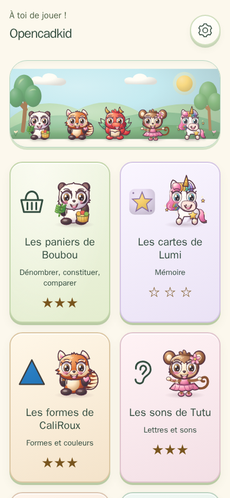
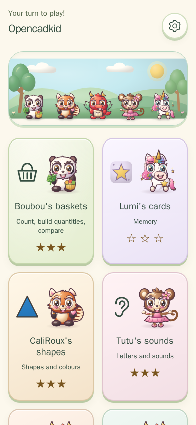
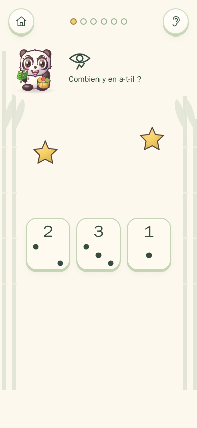
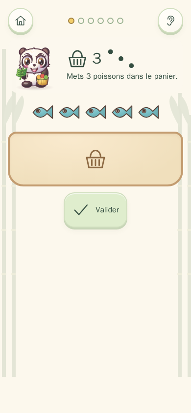
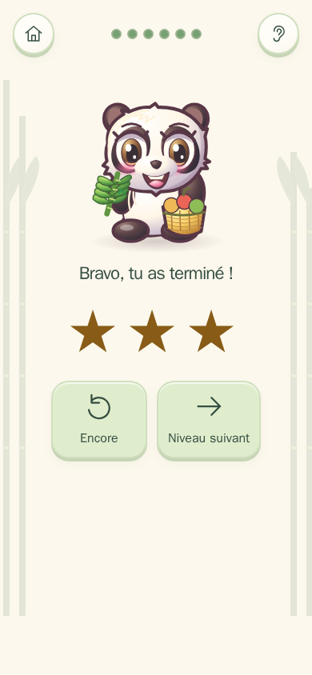
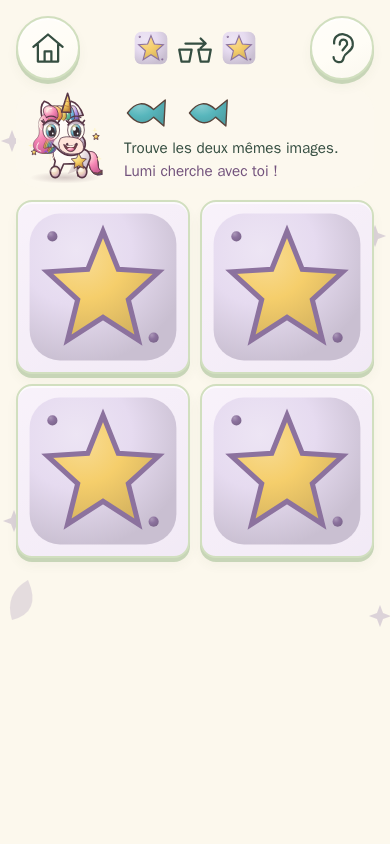

## [▶ Jouer / Play](https://davy45270.github.io/opencadkid/)

# Opencadkid

Jouer en ligne, sans installation, hors ligne une fois ouvert.

[English](README.md) · [Jouer en ligne](https://davy45270.github.io/opencadkid/)

Des petits jeux éducatifs et doux pour les enfants de **4 à 8 ans**, à jouer au doigt, surtout au téléphone. Boubou le panda, CaliRoux le panda roux, Pestouille le dragon, Tutu le singe et Lumi la licorne accompagnent les découvertes. Les dessins sont des SVG générés par le code.

**Disponibles : Les paniers de Boubou, Les cartes de Lumi, Les formes de CaliRoux, Les sons de Tutu, Le puzzle de Pestouille et Le chemin de Pestouille.** Dénombrer, constituer et comparer en huit niveaux, puis jouer à la mémoire avec 2, 3, 4, 6, 8 et 10 paires et un niveau image–ombre. Lumi montre les cartes deux secondes dans les trois premiers niveaux et fait briller une paire déjà vue après des erreurs répétées. Les seize motifs SVG se distinguent par leur silhouette autant que leur couleur. Les vingt cartes tiennent sans défilement sur un téléphone de 390×844. Le français est la langue par défaut ; l’anglais est choisi automatiquement seulement si la langue du téléphone commence par `en`. Le choix des parents est mémorisé.

À venir : Les suites de Lumi, Le rangement de CaliRoux, Les tambours de Tutu et L’atelier de Boubou. Ces quatre jeux sont décrits dans [GAME_SPEC.md](GAME_SPEC.md), sans carte « bientôt » dans le jeu. L’apprentissage de l’heure se trouve dans l’application sœur TicTac, accessible depuis l’accueil après un contrôle parental.

## Jouer et installer

Aucune lecture n’est nécessaire pour jouer : chaque consigne est dite et accompagnée d’un pictogramme. Les réponses associent chiffres et constellations de points. Le premier toucher débloque l’audio ; l’oreille permet de réécouter. La voix dépend du navigateur et du téléphone : une voix française ou anglaise installée localement permet de parler hors ligne. Les consignes restent illustrées si la voix est indisponible.

Ouvrir le jeu une première fois avec une connexion, puis choisir **Installer l’application** ou **Sur l’écran d’accueil** dans le navigateur. Une fois le service worker installé, le jeu entier fonctionne hors ligne. Les sons sont synthétisés sur place.

Pas de chrono, pas de vies, pas d’échec punitif, pas de publicité, pas d’achat, pas de compte, pas de collecte ni d’envoi de statistiques. Une erreur encourage à réessayer ; après deux erreurs, les objets sont surlignés et comptés. Terminer donne toujours des étoiles et débloque le niveau suivant. Les meilleurs scores et les déblocages sont séparés par jeu ; les anciennes sauvegardes de compter restent valides. Progression et réglages restent dans le navigateur. Rien ne sort du téléphone à l’initiative du jeu. Le seul lien externe, vers TicTac, demande une réponse écrite pour adulte.

La roue dentée ouvre le contrôle parental, puis la langue, la voix, les sons et l’effacement de la progression, avec une confirmation supplémentaire. Ce petit contrôle évite une ouverture accidentelle ; il ne vérifie pas l’identité ni l’âge.

**Les formes de CaliRoux** : dix niveaux pour reconnaître huit formes et huit couleurs, les combiner, comparer petit et grand puis glisser les formes dans deux ou trois boîtes de couleur. Les consignes sont dites et illustrées. Les couleurs proches ne sont jamais réunies dans une question ; après deux erreurs, la réponse pulse et son nom est redit. Une erreur ne retire rien. Les étoiles sont conservées séparément.

**Les sons de Tutu** relie un son initial à une grande lettre et à une image dessinée, sans lire. Dix niveaux proposent image–lettre, lettre–image, son seul et tri au doigt dans deux boîtes, en majuscules puis en minuscules. Chaque langue possède son propre lexique de soixante mots pour vingt lettres : changer de langue tire des questions dans le lexique choisi. La voix dit les mots et leurs sons ; aucun mot n’est écrit sous les images. Après deux erreurs, un indice vocal accompagne la lettre qui pulse. Les étoiles et la progression sont indépendantes. La suite de captures facultative produit aussi `sons-image-lettre.png` et `sons-trier.png`.

**Le puzzle de Pestouille** : huit niveaux de 2, 3, 4, 6, 6, 9, 12 pièces puis neuf pièces aux bords ondulés complémentaires. Six scènes dessinées par le code mettent en scène les cinq guides. Glisse une pièce sur le plateau : près de sa place, elle s’aimante et se verrouille ; ailleurs, elle reste où tu la lâches. Le modèle apparaît en filigrane aux deux premiers niveaux, puis avec le bouton œil. Après 25 secondes sans pièce posée, une pièce et sa place pulsent, sans chrono affiché. Terminer donne trois étoiles sans aide, deux avec une aide, sinon une. Au clavier, les flèches déplacent la pièce focalisée de 16 pixels ; Entrée la lâche. Aucune rotation. Progression indépendante.

**Le chemin de Pestouille** : huit labyrinthes parfaits, de 3×3 à 9×7. Trace au doigt jusqu’au nid, au bambou ou à l’arc-en-ciel dessiné. Un mur arrête le trait ; revenir en arrière efface une étape. On peut lever le doigt et reprendre sur le tracé. L’ampoule montre librement les trois prochaines cases. Dès le quatrième niveau, des étoiles facultatives donnent une médaille si elles sont toutes ramassées. Terminer donne toujours trois étoiles et débloque le niveau suivant ; meilleures étoiles et médailles sont sauvegardées séparément. Les flèches avancent d’une case. Les cases mesurent au moins 40 px sur un téléphone de 390×844. Aucun chrono ni compteur de fautes.

La suite chemin produit `chemin-debut.png` et `chemin-fini.png` avec `CAPTURES=1 npm run test:e2e -- --project=mobile tests/e2e/chemin.spec.ts` ; exécution et revue visuelle restent à faire par l’orchestrateur.

## Captures

Les captures seront créées par la suite mobile facultative, après compilation, sur une machine autorisée à lancer les navigateurs : `CAPTURES=1 npm run test:e2e -- --project=mobile tests/e2e/captures.spec.ts`. Elles ne sont pas générées pendant cette passe de rédaction des sources.









La suite puzzle produit `puzzle-debut.png` et `puzzle-fini.png` avec `CAPTURES=1 npm run test:e2e -- --project=mobile tests/e2e/puzzle.spec.ts`. Ces captures attendent une exécution et une revue visuelle par l’orchestrateur.

La suite facultative produit aussi `formes-question.png` et `formes-trier.png` dans `docs/captures/`.

## Développer

Utiliser la version Node de `.nvmrc`.

```sh
npm ci
npm run dev
npm run lint
npm run typecheck
npm test
npm run build
npm run test:e2e
```

La configuration E2E démarre automatiquement `preview` après le build, avec un seul worker, pour un bureau et un téléphone tactile Chromium. Les icônes PWA sont reproductibles avec `node scripts/make-icons.js`, sans dépendance d’image.

Les moteurs purs dans `src/engines/` reçoivent une graine ; ils n’utilisent ni DOM, ni heure, ni hasard ambiant. L’interface dessine et transmet les gestes. Le crochet de lecture `window.__kid.state()` donne une copie détachée de l’état et des rectangles des cibles, avec les motifs, faces visibles, cartes trouvées, coups, erreur en cours et rectangles des cartes de mémoire, sans permettre de modifier le jeu. Les tests vérifient notamment 300 graines par niveau et par quantité disposée. Les E2E couvrent les séries, le doigt bruité, la langue, le contrôle parental et le hors ligne. Les tests ont été écrits sans être exécutés pendant cette livraison ; seuls lint, types et build sont validés localement.

Le catalogue jouable est dans `src/registry.ts`. Les règles et l’oracle des tests sont dans [GAME_SPEC.md](GAME_SPEC.md). La CI vérifie le projet puis Pages déploie lorsque la CI de main réussit. Les actions sont épinglées.

MIT © 2026 David Sevin. Voir [LICENSE](LICENSE) et [SECURITY.md](SECURITY.md).
