## [▶ Jouer / Play](https://davy45270.github.io/opencadkid/)

# Opencadkid

Play online, without installation, offline once opened.

[Français](README.fr.md) · [Play online](https://davy45270.github.io/opencadkid/)

Gentle educational games for children aged **4–8**, designed for fingers and phones. Boubou the panda, CaliRoux the red panda, Pestouille the dragon, Tutu the monkey and Lumi the unicorn guide each discovery. All artwork is generated in SVG from code.

**17 games available: Boubou’s baskets, Lumi’s cards, CaliRoux’s shapes, Tutu’s sounds, Pestouille’s puzzle, Pestouille’s path, Lumi’s patterns, CaliRoux’s tidy-up, Tutu’s drums, Boubou’s snack, Tutu’s hiding places, Lumi’s walk, Boubou’s bubbles, Lumi’s sweets, Lumi’s crossing, Boubou’s boxes and Boubou’s studio.**

Boubou's baskets — count, fill and compare across sixteen levels, up to baskets that differ by one and counting one kind among two — and **Lumi's cards**, a gentle memory game with 2 to 12 pairs across fourteen levels: identical pictures, a picture and its shadow, then two identical shadows matched by outline alone. Lumi offers a two-second preview on the first three levels and a glowing hint after repeated misses. Sixteen procedural shapes remain distinguishable without colour; the largest board fits a 390×844 phone without scrolling. French comes first; English is included. English is selected automatically only when the device language starts with `en`. Adults can change and save the language.

**CaliRoux's shapes** is also available: twenty levels of shapes, colours, combinations, sizes, an odd one out and finger sorting into two to four colour boxes. Eight outlined SVG shapes and eight named colours accompany spoken prompts; close colour pairs never share a question. Two errors make the answer glow and repeat its name.

The complete catalogue is described in [GAME_SPEC.md](GAME_SPEC.md). Learning to tell time is available in the sister application TicTac, through an adult-gated home card.

No reading is required to play: spoken instructions accompany pictograms, objects and dot constellations. The first touch enables browser audio. Voice availability depends on the device's speech service; install a local French or English voice for spoken play offline. The ear button repeats an instruction. A silent device still shows the visual prompts.

There are no timers, lives, punitive failures, ads, purchases, accounts or analytics. Mistakes invite another try; two mistakes trigger a counting hint. Finishing a guided game always earns stars and unlocks the next level. The studio has no score or imposed goal. Each game keeps its own best stars and unlocks; older counting saves remain valid. Progress and preferences stay in local browser storage. The app makes no external runtime requests. An adult's written challenge protects settings and the external TicTac link. This is a light parental gate, not an identity or security check.

## Install and play offline

Open the online game once while connected. Use your browser's **Install app** or **Add to Home Screen** option. After the service worker has installed, the entire game reloads offline. Sounds are synthesized locally. Use the gear to change voice/sounds/language or erase progress, with a separate confirmation. Nothing is sent off the phone by this app.

**Tutu’s sounds** connects a spoken initial sound to a large letter and a drawn picture, without reading. Ten levels cover picture-to-letter, letter-to-picture, sound-only listening and dragging pictures into two letter boxes, with uppercase then lowercase letters. French and English each have their own sixty-word lexicon across twenty letters: changing language selects native questions. The voice names pictures and sounds; no written word appears beneath a picture. Two errors bring a spoken and pulsing hint. Progress and best stars are saved separately.

**Pestouille’s puzzle** offers eight levels: 2, 3, 4, 6, 6, 9, 12 pieces, then nine pieces with complementary curved edges. Twelve scenes feature the five guides: six drawn by code and six painted landscapes (a zen garden, the Ardennes forest, a fiery volcano, tropical islands, a starry galaxy and a spring valley), loaded only when the puzzle shows them and kept for offline play. Slide pieces into the upper board: a gentle snap locks a close piece, while a missed drop stays where it lands. The first two levels show a faint model; the eye reveals it later. After 25 seconds without placing a piece, a pulsing piece and outline offer help; no clock appears. Finish for three stars without help, two with one aid, otherwise one. Arrow keys move a focused piece 16 pixels; Enter drops it. No rotation. Progress stays separate from other games.

**Pestouille’s path** offers eight perfect mazes, from 3×3 to 9×7. Trace with a finger to reach a drawn nest, bamboo or rainbow. Walls stop the line gently; retracing erases one step. Lift and resume anywhere on your line. The bulb shows the next three cells, freely. From level four, optional stars reward exploration with a medal when all are collected. Finishing always gives three stars and unlocks the next maze; best stars and medals stay saved separately. Arrow keys move one cell. Cells measure at least 40 px on a 390×844 phone. No timer or mistake counter.

**Lumi’s patterns** offers ten levels: extend AB, AAB, ABB, ABC, AABB and ABCD motifs, fill a middle gap, place the next two objects in order by touch or drag, then grow dot groups by one. Beads, flowers and outlined shapes always differ beyond colour. Two errors outline the base motif and Lumi names it aloud. Every completed six-question round earns stars and unlocks the next level; best stars are saved separately. Illustrations measure 48 px and choices at least 72 px. On a 390×844 phone the sequence fits two rows without scrolling. Reduced motion removes the gentle empty-slot pulse.

**CaliRoux’s tidy-up** adds eight levels of sorting: colour, simplified shape, small/large, category, three bins, two combined clues and a unique odd one out. Thirty everyday drawings in 180 colour/size variants have bilingual spoken names. Touch an object then its bin, or drag with a gentle 24 px snap. Two misses on the same object pulse the right bin and repeat the rule; wrong objects return softly without a negative sound. Non-colour rules cannot be solved by colour alone. Bins measure at least 96 px, object targets 88 px and actual painted extent at least 56 px. A pale bedroom accompanies separate best stars and unlocks.

**Tutu’s drums** adds eight levels of rhythm and listening: repeat sequences of two to six beats on four, five or six instruments, imitate short/long intervals, then compose eight beats for Tutu to replay. Each instrument has a distinct shape and pentatonic note. Quiet WebAudio tones can be disabled in parent settings; lights keep every demonstration playable without audio. Mistakes replay more slowly, two mistakes pulse the next drum and gently shorten repeated sequences within the level bounds. Timing tolerance is ±35%. Every finger plays on contact, including simultaneous fingers and intentional rapid double taps. Reduced motion keeps lights without bouncing. Best stars and unlocks are saved independently.

**Boubou’s snack**: a sweet hangs from strings above Boubou the panda. Cut a string with a tap, or several with one swipe, and the sweet swings, falls and, with good timing, lands in Boubou’s mouth. Bubbles lift the sweet until a touch pops them, hooks catch it when it passes close, and slack strings catch it on the way down. 116 levels, sixteen drawn by hand and a hundred generated, each checked by a solver that tries every cut at every moment: always finishable, three stars reachable, timing forgiving for small hands. A missed sweet floats away and the level starts again by itself: no lives, no timer. Stars caught on the way are the reward.

**Lumi’s walk**: Lumi’s five little ones come out of a trapdoor and walk to a rainbow door. In front of a ditch, a wall, soft earth or a step too high, they stop and wait at the edge: nobody ever falls, there is no clock and no lives. The child touches the little one who waits and picks one of the big picture buttons: bridge, tunnel, hole or ladder. A wrong one is tried for real and turns into a funny little scene (a tunnel dug over a ditch ends in a splash, a bridge against a wall folds up like an accordion…), then the little one waits again with nothing lost; after three tries Lumi shows the right one. The scenery plays too, always waiting for a touch: a lost rabbit, hedgehog or duckling who follows the troupe to the door, a sleeping bear to tickle, a leaf boat, a flower that lowers a drawbridge, fireflies in a cave, balloons over a rock, a bouncy mushroom, a tasty rainbow and treats to pick. 52 hand-written scenes, each with a title Lumi says and its own strong moment, in eight sceneries (meadow, autumn, beach, mountain, forest, snow, rain, night), checked by a solver and by variety checks.

**Boubou’s bubbles**: Boubou the panda throws coloured bubbles at a cluster hanging from the sky. The child puts a finger down, a long dotted line shows the way with its bounces, and letting go throws. Three of a colour that touch fly away as butterflies, and what no longer hangs falls gently and turns into flowers. No clock, no lives, nothing to lose: a throw that does nothing just sticks, often with a funny face — boing on the ceiling while Boubou scratches his head, a kiss, a sneeze, a dizzy spin. Each colour also has its shape. 32 little scenes bring in, one by one, the rainbow bubble, clouds, friends to set free, ice cubes, a swinging cluster and planks; after three throws for nothing, a golden line shows a good throw.

**Lumi’s sweets**: a board of drawn sweets, each colour with its own shape (heart, diamond, star, square, round, berlingot). Swap two neighbouring sweets by sliding a finger or with two touches; three alike or more in a line jump into Lumi’s jar and the others fall to fill the gaps. No clock, no move limit, no lives, nothing to lose: a swap that does nothing is not refused, the two sweets bump heads, leapfrog, blush, tickle or stick to the chocolate, then come back. The board never gets stuck: with no swap left, Lumi mixes it. 32 hand-written scenes, each with a title Lumi says and its own strong moment, bring in one by one the rainbow sweet, the wrapped sweet that jumps, the sugar cube that melts in two times, the cherry and the gummy bear to bring down, shaped boards (heart, house, hourglass, cake, rocket) and chocolate that spreads; after three tries without a line, two sweets shine to show a good swap.

**Lumi’s crossing**: one of Lumi’s foals, or Boubou, crosses roads, a river and rails to get home, to Lumi or to a picnic. Turn by turn: nothing moves until the child slides a finger or touches a big arrow, and each step of the little one moves cars, logs, ducks and lilies one step, so the child always sees what will happen. No clock, no lives, nothing to lose: under a car, the car honks and brakes and the little one jumps back with a surprised face; next to a log, splash, it comes out dripping and shakes off; trucks honk, the tractor pushes gently, ducks bump, the train whistles at the barrier. 34 hand-written scenes, each with a title Lumi says and its own strong moment, bring in one by one two-way roads, trucks, the slow tractor, logs, diving lilies, ducks, the train, a friend to fetch, a snack to pick, a traffic light to touch and an eye button to watch the world move; after three funny tries, the right next step shines.

**Boubou’s boxes**: Boubou tidies his toys in the garden. Each crate holds a toy with its own colour (balloon, teddy, car, star, frog) and goes on a spot, then on the spot drawn with its toy. Slide a finger or touch a big arrow: Boubou pushes the crate in front of him; touch the crate stuck to him, then step back, and he pulls it, so a crate stuck in a corner always comes out and nothing is ever lost. No clock, no step limit, no lives: a step that does not work is a funny try, Boubou bumps his nose, the crate makes big eyes, two crates are too heavy, the teddy shakes its head on the balloon’s drawing, and nothing on the board changes. A big free back button undoes any step. 32 hand-written scenes, each with a title Boubou says and its own strong moment, bring in one by one pulling, toys on their own drawings, the pond, belts, the gate and its button, ice and holes to fill; after three funny tries, or forty steps without a new toy put away, the right next step shines.

**Tutu’s hiding places**: objects hide in a painted landscape (the puzzle's six paintings); find the ones shown in the strip with a tap. Twelve levels go from three large objects with two in the way, to eight small ones among fourteen others, some half hidden behind the scenery. Every object stands on the ground of the painting, at the size its distance gives it, with its shadow and the light of the place. Three misses in a row make one object to find shine. The objects are the props of Petits Pompiers and Opencadkid's own fruits, all precached for offline play.

**Boubou’s studio**: colour ten procedural drawings (the five guides, a house, a tree, a fish, a rocket and a butterfly) and their background, paint over them with the brush, or draw freely on a blank page. Twelve named colours, a white eraser, three brush sizes and forty undo/redo steps support calm exploration. The play button makes the model move — wings flap, a tail wags, the rocket takes off — with only the child’s colours. The sheet in progress stays on the device after leaving or reloading, and the save button stores the picture as a PNG file on the device. Touch “I’m done” for Boubou’s stamp and a local gallery of at most twelve creations. No artwork is uploaded. Parents can erase the gallery after confirmation. Gallery persistence depends on available browser storage; an unavailable store leaves the current sheet playable.

## Screenshots

Phone screenshots (390×844).

| | |
|---|---|
| 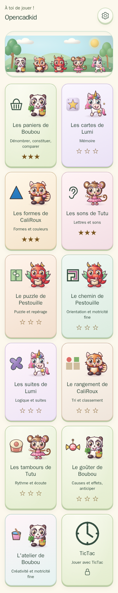<br>All eleven games | 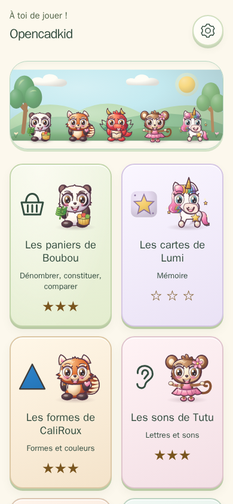<br>Home (French) |
| 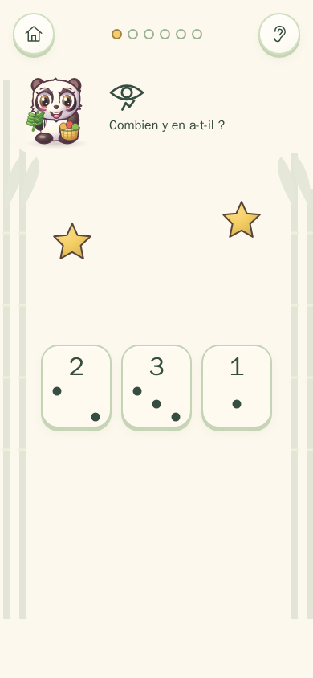<br>Boubou's baskets: how many? | 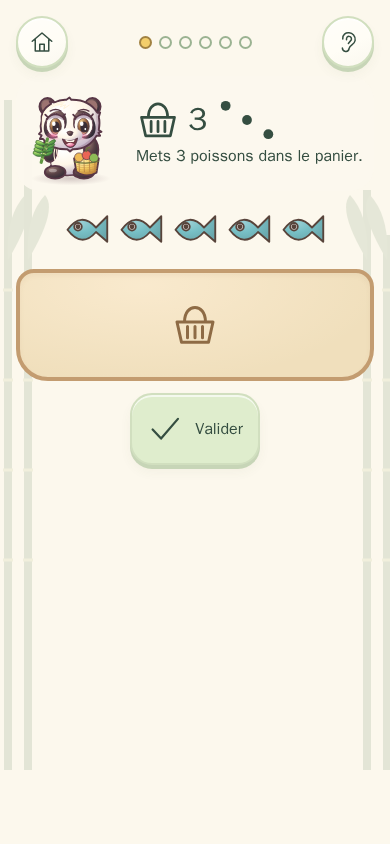<br>Boubou's baskets: fill the basket |
| 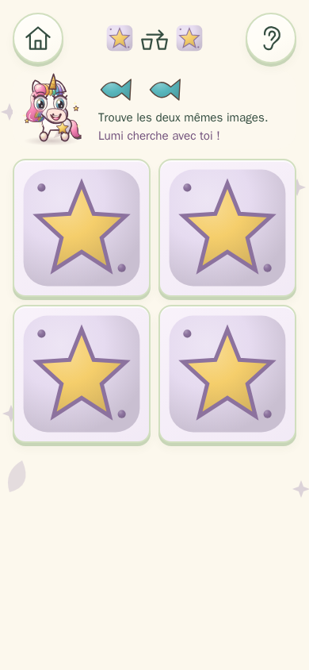<br>Lumi's cards | 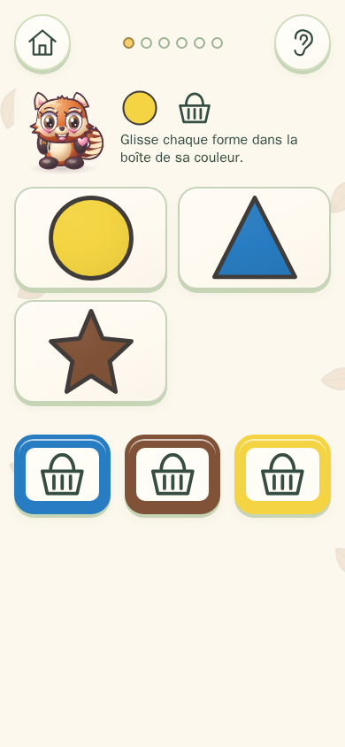<br>CaliRoux's shapes: sort by colour |
| 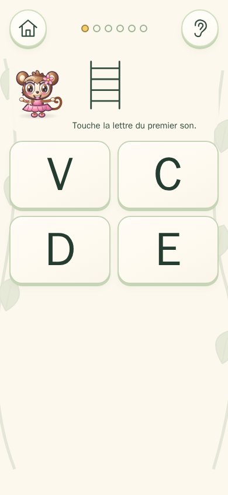<br>Tutu's sounds | 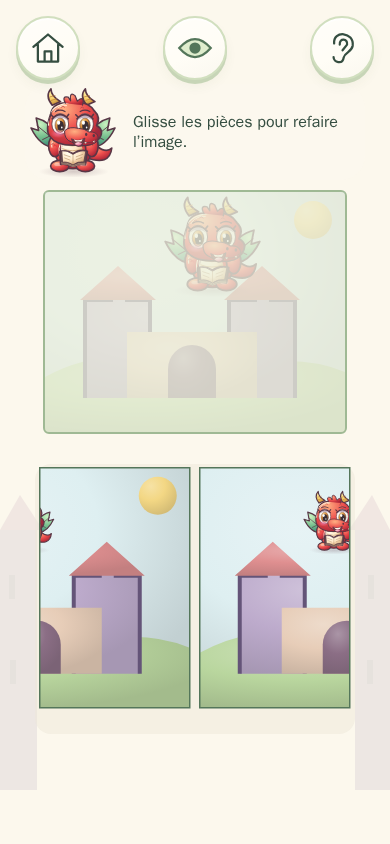<br>Pestouille's puzzle |
| 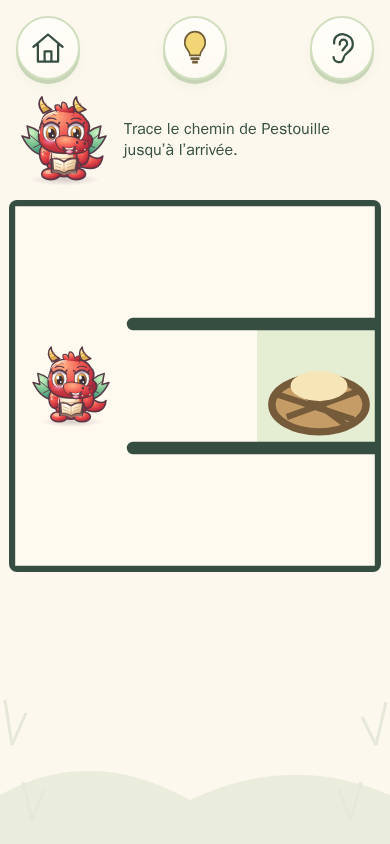<br>Pestouille's path | 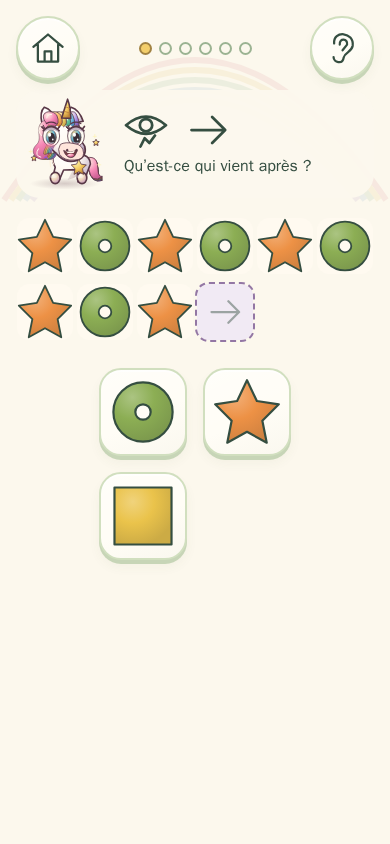<br>Lumi's patterns |
| 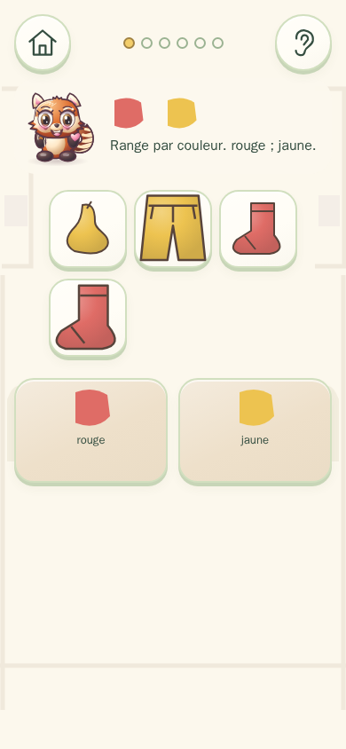<br>CaliRoux's tidy-up | 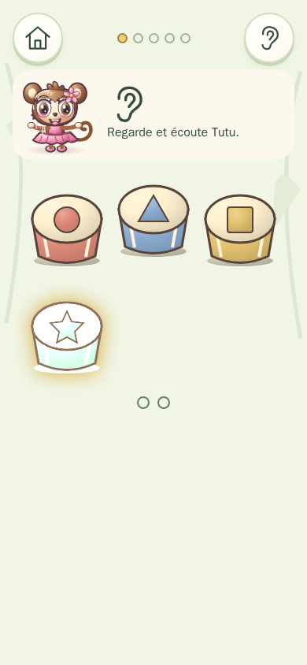<br>Tutu's drums |
| 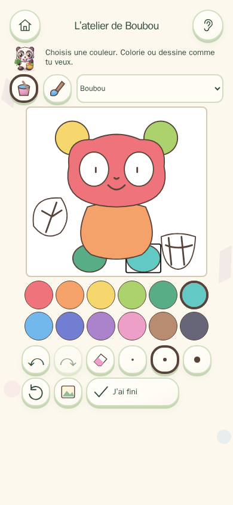<br>Boubou's studio | 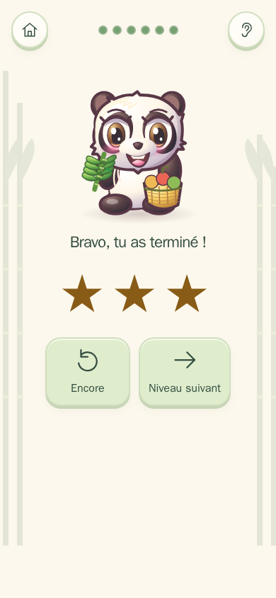<br>End of a series: always rewarded |
| 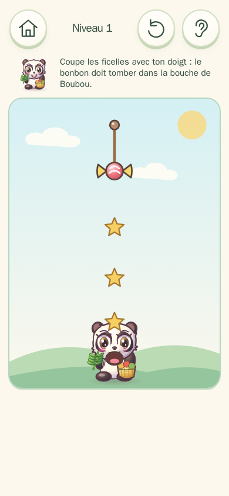<br>Boubou's snack: cut the string | 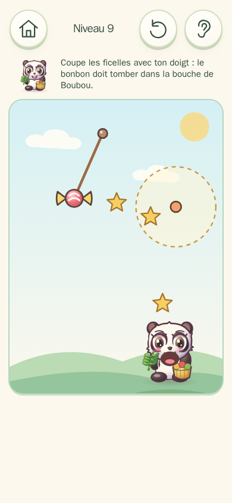<br>A hook catches the sweet |
| 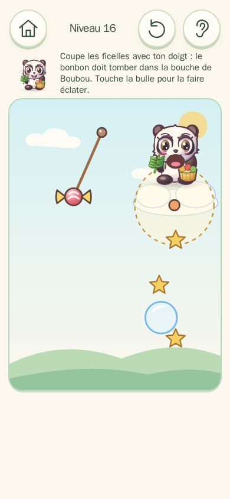<br>String, hook and bubble | 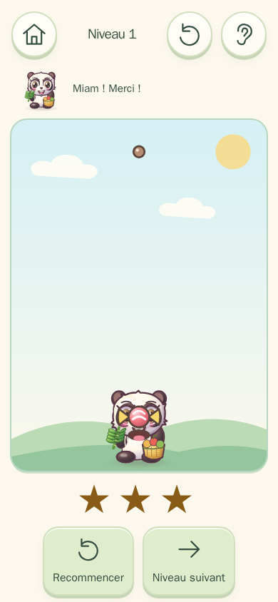<br>Yum! Three stars |
| 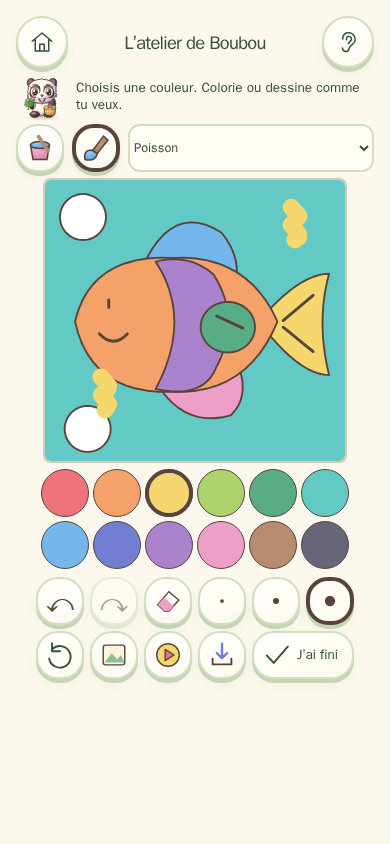<br>Studio: background and brush over the model | 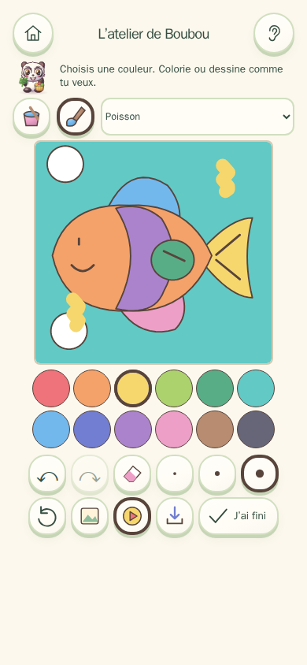<br>Studio: the coloured model moves |

## Develop

Use the Node version in `.nvmrc`.

```sh
npm ci
npm run dev
npm run lint
npm run typecheck
npm test
npm run build
npm run test:e2e
```

Preview serves the built `dist` directory. The E2E configuration starts preview automatically, with one worker and desktop and touch-phone Chromium projects. Regenerate the three committed PWA icons with `node scripts/make-icons.js` (Node only, no image dependencies).

Pure engines live in `src/engines/`; they receive seeds and never access the DOM, time or ambient randomness. The UI draws SVG and forwards gestures. `window.__kid.state()` returns a detached snapshot containing the screen, current question, memory board (motifs, visible/found cards, moves, mismatch and card rectangles) and target rectangles; this read-only observation hook cannot change progress. Vitest covers 300 seeds per level and per layout quantity; E2E covers complete games, noisy fingers, parental controls, language and offline reloads. CI runs lint, typecheck, the unit tests, the build and the precache check on every push, then only the E2E specs that `scripts/e2e-impact.js` picks for the change (never the whole E2E suite).

The public game registry contains playable games only. Follow [GAME_SPEC.md](GAME_SPEC.md) when adding a game. GitHub Actions checks the app, then deploys a successful main-branch CI build to Pages. All action versions are pinned.

MIT © 2026 David Sevin. See [LICENSE](LICENSE). Report vulnerabilities as described in [SECURITY.md](SECURITY.md).
